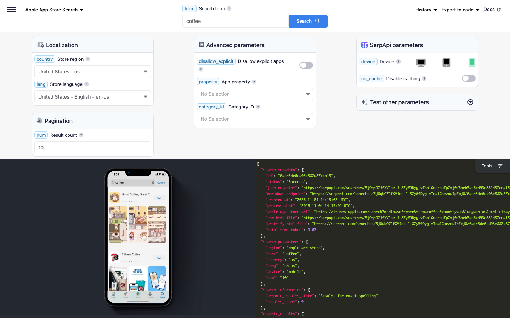

# Apple App Store Scraper

Scrape Apple App Store search results with SerpApi's Apple App Store API. Search apps by keyword, category, or developer, and get each app's ID, title, developer, price, ratings, genres, version, release dates, screenshots, and links to its product page and reviews.

## How to scrape the Apple App Store

Search the App Store with a simple GET request:

```text
https://serpapi.com/search?engine=apple_app_store&term=coffee&api_key=SERPAPI_API_KEY
```

- `term` is the search term: anything you'd type in the App Store search, such as an app name or a keyword.
- `api_key` is your SerpApi API key. Replace `SERPAPI_API_KEY` with it.
- `country` and `lang` set the App Store region and language, e.g., `us` and `en-us`.
- `category_id` limits the results to a category, e.g., `6014` for Games.
- `property=developer` searches developer names instead, e.g., apps by Coffee Inc. for `term=coffee`.
- `num` sets the number of results, from 10 (default) up to 200.

[Register at SerpApi](https://serpapi.com?utm_source=github_apple_app_store_scraper) to get your API key, and keep it private.

### Playground

Try the request live in the [SerpApi Playground](https://serpapi.com/playground?engine=apple_app_store&term=coffee&utm_source=github_apple_app_store_scraper).

[](https://serpapi.com/playground?engine=apple_app_store&term=coffee&utm_source=github_apple_app_store_scraper)

## Code examples

The code examples read your API key from the `SERPAPI_API_KEY` environment variable:

```bash
export SERPAPI_API_KEY="SERPAPI_API_KEY"
```

Each example searches the App Store for “coffee” and prints the position, title, and link of each app.

### curl integration

Send the request with curl, which prints the full JSON response:

```bash
curl --get https://serpapi.com/search \
 --data-urlencode engine="apple_app_store" \
 --data-urlencode term="coffee" \
 --data-urlencode api_key="$SERPAPI_API_KEY"
```

### JavaScript integration

Install the [SerpApi JavaScript library](https://github.com/serpapi/serpapi-javascript) and set your project to use ES modules:

```bash
npm install serpapi
npm pkg set type=module
```

Create an `index.js` file:

```javascript
import { getJson } from "serpapi";

const results = await getJson({
  engine: "apple_app_store",
  api_key: process.env.SERPAPI_API_KEY,
  term: "coffee",
});

for (const result of results.organic_results ?? []) {
  console.log(result.position, result.title, result.link);
}
```

Run it with `node index.js`.

### Python integration

Install the [SerpApi Python library](https://github.com/serpapi/serpapi-python):

```bash
pip install serpapi
```

Create a `main.py` file:

```python
import os
import serpapi

client = serpapi.Client(api_key=os.getenv("SERPAPI_API_KEY"))
results = client.search({
    "engine": "apple_app_store",
    "term": "coffee",
})

for result in results.get("organic_results", []):
    print(result["position"], result["title"], result["link"])
```

Run it with `python main.py`.

### Ruby integration

Install the [SerpApi Ruby library](https://github.com/serpapi/serpapi-ruby):

```bash
gem install serpapi
```

Create a `main.rb` file:

```ruby
require "serpapi"

client = SerpApi::Client.new(engine: "apple_app_store", api_key: ENV.fetch("SERPAPI_API_KEY"))
results = client.search(term: "coffee")

results.fetch(:organic_results, []).each do |result|
  puts "#{result[:position]} #{result[:title]} #{result[:link]}"
end

client.close
```

Run it with `ruby main.rb`.

### PHP integration

Install the [SerpApi PHP library](https://github.com/serpapi/serpapi-php):

```bash
composer require serpapi/serpapi-php
```

Create an `index.php` file:

```php
<?php
require 'vendor/autoload.php';

use SerpApi\Client;

$client = new Client(getenv('SERPAPI_API_KEY'), 'apple_app_store');
$results = $client->search([
  'term' => 'coffee',
]);

foreach ($results->organic_results ?? [] as $result) {
  echo $result->position . ' ' . $result->title . ' ' . $result->link . PHP_EOL;
}
```

Run it with `php index.php`.

### Go integration

Create a Go module and install the [SerpApi Go library](https://github.com/serpapi/serpapi-golang):

```bash
go mod init example.com/appstore
go get github.com/serpapi/serpapi-golang
```

Create a `main.go` file:

```go
package main

import (
	"fmt"
	"os"

	"github.com/serpapi/serpapi-golang"
)

func main() {
	setting := serpapi.NewSerpApiClientSetting(os.Getenv("SERPAPI_API_KEY"))
	setting.Engine = "apple_app_store"
	client := serpapi.NewClient(setting)

	results, err := client.Search(map[string]string{
		"term": "coffee",
	})
	if err != nil {
		panic(err)
	}

	organicResults, _ := results["organic_results"].([]interface{})
	for _, item := range organicResults {
		result := item.(map[string]interface{})
		fmt.Println(result["position"], result["title"], result["link"])
	}
}
```

Run it with `go run .`.

### Rust integration

Create a Cargo project and add the [SerpApi Rust library](https://github.com/serpapi/serpapi-rust) and Tokio:

```bash
cargo new app-store && cd app-store
cargo add serpapi tokio --features tokio/full
```

Replace `src/main.rs` with:

```rust
use serpapi::serpapi::Client;
use std::collections::HashMap;
use std::env;

#[tokio::main]
async fn main() -> Result<(), Box<dyn std::error::Error>> {
    let mut default = HashMap::new();
    default.insert("api_key".to_string(), env::var("SERPAPI_API_KEY")?);
    default.insert("engine".to_string(), "apple_app_store".to_string());
    let client = Client::new(default)?;

    let mut parameter = HashMap::new();
    parameter.insert("term".to_string(), "coffee".to_string());

    let results = client.search(parameter).await?;
    if let Some(organic_results) = results["organic_results"].as_array() {
        for result in organic_results {
            println!(
                "{} {} {}",
                result["position"],
                result["title"].as_str().unwrap_or_default(),
                result["link"].as_str().unwrap_or_default()
            );
        }
    }
    Ok(())
}
```

Run it with `cargo run`.

### Other programming languages

Official libraries are also available for [Java](https://github.com/serpapi/serpapi-java), [.NET](https://github.com/serpapi/serpapi-dotnet), [Swift](https://github.com/serpapi/serpapi-swift), and [C++](https://github.com/serpapi/serpapi-cpp). See [SerpApi integrations](https://serpapi.com/integrations?utm_source=github_apple_app_store_scraper) for setup guides, or use a simple GET request from any programming language.

### Errors

Failed requests return an HTTP error status and a JSON body with an `error` message. The most common are `401` for an invalid API key, `400` for a missing required parameter such as `term`, and `429` when you exceed your hourly throughput limit or run out of searches. See [API status and error codes](https://serpapi.com/api-status-and-error-codes?utm_source=github_apple_app_store_scraper) for the full list.

## Output formats: JSON and Markdown

Choose structured JSON for applications or Markdown for LLMs and AI agents:

- JSON is the default output and is useful when you need individual result fields.
- Add `output=md` to receive Markdown instead, which is more token-efficient.

Markdown is plain text, not JSON: YAML front matter with the search metadata, followed by tables of the results. Read the response body as text instead of parsing it.

| Client | Markdown request |
|--------|------------------|
| curl | `--data-urlencode output="md"` |
| Python | `client.search({..., "output": "md"})` |
| PHP | `$client->md([...])` |
| Rust | `client.md(parameter).await?` |

If your SDK doesn't have a Markdown helper yet, send a plain HTTP request with `output=md` and read the body as text. Learn more about [Markdown output](https://serpapi.com/markdown-output?utm_source=github_apple_app_store_scraper).

## Apple App Store API parameters

See the [Apple App Store API documentation](https://serpapi.com/apple-app-store?utm_source=github_apple_app_store_scraper) for more details.

| Name | Description | Requirement |
|------|-------------|-------------|
| **Search query** | | |
| `term` | The search term: anything you'd use in a regular App Store search (e.g., `coffee`). | Required |
| **Localization** | | |
| `country` | The App Store region to search, as a two-letter country code (e.g., `us`, `uk`, `fr`). Defaults to `us`. See [Apple regions](https://serpapi.com/apple-regions?utm_source=github_apple_app_store_scraper) for supported regions. | Optional |
| `lang` | The App Store language, as a language and region code (e.g., `en-us`, `fr-fr`, `uk-ua`). Defaults to `en-us`. See [Apple languages](https://serpapi.com/apple-languages?utm_source=github_apple_app_store_scraper) for supported languages. | Optional |
| **Pagination** | | |
| `num` | The number of results. Defaults to `10`, up to `200`. Larger values return 200 results. | Optional |
| **Advanced parameters** | | |
| `category_id` | Only return apps with this category, or genre (e.g., `6014` for Games). See [Apple categories](https://serpapi.com/apple-categories?utm_source=github_apple_app_store_scraper) for supported categories. | Optional |
| `property` | Set to `developer` to search developer names (e.g., `term=coffee` returns apps by developers with Coffee in their name). | Optional |
| `disallow_explicit` | Set to `true` to exclude explicit apps. Defaults to `false`. | Optional |
| **SerpApi parameters** | | |
| `engine` | Set to `apple_app_store`. | Required |
| `api_key` | Your private SerpApi API key. | Required |
| `device` | Set to `desktop`, `tablet`, or `mobile`. | Optional |
| `no_cache` | Set to `true` to request fresh results instead of using the one-hour cache. Can't be combined with `async`. | Optional |
| `async` | Set to `true` for later retrieval through the [Searches Archive API](https://serpapi.com/search-archive-api?utm_source=github_apple_app_store_scraper). Can't be combined with `no_cache` or used with Ludicrous Speed enabled. | Optional |
| `zero_trace` | Enterprise only. Set to `true` to skip storing search parameters, files, and metadata on SerpApi servers. | Optional |
| `output` | Set to `json` (default), `html` for the raw HTML retrieved, or `md` for Markdown. | Optional |
| `json_restrictor` | Limit the JSON response to the fields you need. See the [JSON Restrictor](https://serpapi.com/json-restrictor?utm_source=github_apple_app_store_scraper) documentation. | Optional |

## Available data on the Apple App Store (JSON response)

Each item in `organic_results` is an app. The field guides below describe the possible fields and their types; they aren't literal API responses.

### What you get depends on the app

Some fields appear only for some apps:

| App | Fields |
|-----|--------|
| A paid app | `price.amount`, `price.currency`, and `price.symbol` |
| An app with iPad screenshots | `screenshots.ipad` |
| An app with content warnings | `advisories`, e.g., Infrequent/Mild Cartoon or Fantasy Violence |
| An app with special features | `features`, e.g., `gameCenter` or `iosUniversal` |

Each app has a `serpapi_product_link` to its full product page with the [Apple App Store Product API](https://serpapi.com/apple-product?utm_source=github_apple_app_store_scraper), and a `serpapi_reviews_link` to its reviews with the [Apple App Store Reviews API](https://serpapi.com/apple-reviews?utm_source=github_apple_app_store_scraper).

To get more apps, increase `num` up to 200.

### Organic results

Each result in `organic_results` can include these fields:

```json
{
  "organic_results": [
    {
      "position": "Integer - Position of the app in the results",
      "id": "Integer - App Store ID of the app, e.g., 331177714",
      "title": "String - Name of the app",
      "bundle_id": "String - Bundle ID of the app, e.g., com.starbucks.mystarbucks",
      "version": "String - Latest version number, e.g., 6.134.1",
      "vpp_license": "Boolean - Whether businesses can buy the app in volume through the Apple Volume Purchase Program",
      "age_rating": "String - Age rating, e.g., 4+",
      "release_note": "String - Release notes of the latest version",
      "seller_link": "String - Link to the developer's website for the app",
      "minimum_os_version": "String - Minimum OS version needed to install the app, e.g., 15.0",
      "description": "String - Description of the app",
      "game_center_enabled": "Boolean - Whether the app supports Game Center",
      "link": "String - Link to the app on the App Store",
      "serpapi_product_link": "String - SerpApi link to the product page of the app",
      "serpapi_reviews_link": "String - SerpApi link to the reviews of the app",
      "release_date": "String - Release date of the app, e.g., 2025-02-27 08:00:00 UTC",
      "latest_version_release_date": "String - Release date of the latest version",
      "price": {
        "type": "String - Free, Paid, or Free Trial",
        "amount": "Float - Price of a paid app, e.g., 4.99",
        "currency": "String - Three-letter currency code, e.g., USD",
        "symbol": "String - Currency symbol, e.g., $"
      },
      "rating": [
        {
          "type": "String - Period of the rating, e.g., All Times",
          "rating": "Float - Average rating, e.g., 4.89",
          "count": "Integer - Number of ratings"
        }
      ],
      "genres": [
        {
          "name": "String - Genre of the app, e.g., Food & Drink",
          "id": "Integer - ID of the genre, e.g., 6023",
          "primary": "Boolean - Whether it's the primary genre of the app"
        }
      ],
      "developer": {
        "name": "String - Name of the developer",
        "id": "Integer - App Store ID of the developer",
        "link": "String - Link to the developer's page on the App Store"
      },
      "size_in_bytes": "Integer - Size of the app in bytes",
      "supported_languages": "Array[String] - Two-letter codes of the supported languages, e.g., EN, FR",
      "screenshots": {
        "general": [
          {
            "link": "String - Link to the screenshot",
            "size": "String - Size of the screenshot, e.g., 392x696"
          }
        ],
        "ipad": [
          {
            "link": "String - Link to the iPad screenshot",
            "size": "String - Size of the screenshot, e.g., 360x480"
          }
        ]
      },
      "logos": [
        {
          "size": "String - Size of the icon, e.g., 512x512",
          "link": "String - Link to the icon"
        }
      ],
      "features": "Array[String] - Supported features, e.g., gameCenter, iosUniversal",
      "supported_devices": "Array[String] - Supported devices, e.g., iPhone5s, iPadAir",
      "advisories": "Array[String] - Content warnings, e.g., Infrequent/Mild Cartoon or Fantasy Violence"
    }
  ]
}
```

### Search information

`search_information` describes the results:

```json
{
  "search_information": {
    "organic_results_state": "String - Whether the results match the exact spelling, e.g., Results for exact spelling",
    "results_count": "Integer - Number of apps returned"
  }
}
```

## AI agents and no-code

### MCP

Give AI agents and assistants an App Store search tool with the hosted [SerpApi MCP server](https://github.com/serpapi/serpapi-mcp) at `https://mcp.serpapi.com/mcp`.

Claude Code:

```bash
claude mcp add --transport http serpapi https://mcp.serpapi.com/mcp --header "Authorization: Bearer $SERPAPI_API_KEY"
```

Codex, which reads the key from `SERPAPI_API_KEY`:

```bash
codex mcp add serpapi --url https://mcp.serpapi.com/mcp --bearer-token-env-var SERPAPI_API_KEY
```

Other MCP clients:

```json
{
  "mcpServers": {
    "serpapi": {
      "type": "http",
      "url": "https://mcp.serpapi.com/SERPAPI_API_KEY/mcp"
    }
  }
}
```

The server's engine catalog includes the `apple_app_store` engine, and its `serpapi://engines/apple_app_store` resource describes the parameters. Ask your agent to search the App Store with the `apple_app_store` engine. The resulting tool call looks like this:

```json
{
  "name": "search",
  "arguments": {
    "params": {
      "engine": "apple_app_store",
      "term": "coffee"
    }
  }
}
```

See the [MCP integration guide](https://serpapi.com/integrations/mcp?utm_source=github_apple_app_store_scraper) for more clients and self-hosting.

### CLI

Search the App Store from your terminal or from AI agent workflows with the [SerpApi CLI](https://github.com/serpapi/serpapi-cli):

```bash
brew tap serpapi/homebrew-tap
brew install serpapi-cli
```

The CLI picks up `SERPAPI_API_KEY` from your environment. You can also run `serpapi login` to save a key.

```bash
serpapi search engine=apple_app_store term=coffee
serpapi search engine=apple_app_store term=coffee --fields "organic_results[].{title, link}"
serpapi search engine=apple_app_store term=coffee output=md
```

### No-code tools

Use SerpApi APIs without writing code:

- [NoCodeSerpApi](https://nocodeserpapi.com/)
- [SerpApi with n8n](https://serpapi.com/blog/tag/n8n/)
- [SerpApi with Make](https://serpapi.com/blog/tag/make/)
- [More integrations](https://github.com/serpapi/serpapi-integrations/)

## Use cases

- Track where your app ranks for keywords in App Store search.
- Monitor the ratings, prices, versions, and release notes of competing apps.
- Build app discovery and comparison features with icons, screenshots, and genres.
- Research a category with `category_id`, or a developer's apps with `property=developer`.
- Compare App Store results across countries and languages.
- Give AI agents and RAG pipelines an app search tool.

## Related scrapers

- [Apple App Store Product Scraper](https://github.com/serpapi/apple-app-store-product-scraper): the full product page of an app
- [Apple App Store Reviews Scraper](https://github.com/serpapi/apple-app-store-reviews-scraper): reviews of an app
- [Google Play Store Scraper](https://github.com/serpapi/google-play-scraper): apps, games, movies, and books on Google Play

## Resources

- [Easily scrape Apple App Store and filter results by categories for better insights](https://serpapi.com/blog/easily-scrape-apple-app-store-and-filter-results-by-categories-for-better-insights/)
- [How to Scrape Apple AppStore](https://serpapi.com/blog/how-to-scrape-apple-appstore/)
- [Scraping Apple App Store Search with Python](https://serpapi.com/blog/scraping-apple-app-store-search-with-python/)
- [Web scraping Apple App Store Search with Nodejs](https://serpapi.com/blog/web-scraping-apple-app-store-search-with-nodejs/)
- [Maximize Your App's Visibility and Downloads with Multiple Regression and Apple App Store Search Scraper API](https://serpapi.com/blog/maximize-your-apps-visibility-and-downloads-with-multiple-regression-and-apple-app-store-search-scraper-api/)
- [SerpApi's Apple App Store Search Scraper API](https://serpapi.com/blog/serpapis-apple-app-store-search-scraper-api/)

## Contact

Feel free to reach out at [contact@serpapi.com](mailto:contact@serpapi.com).
